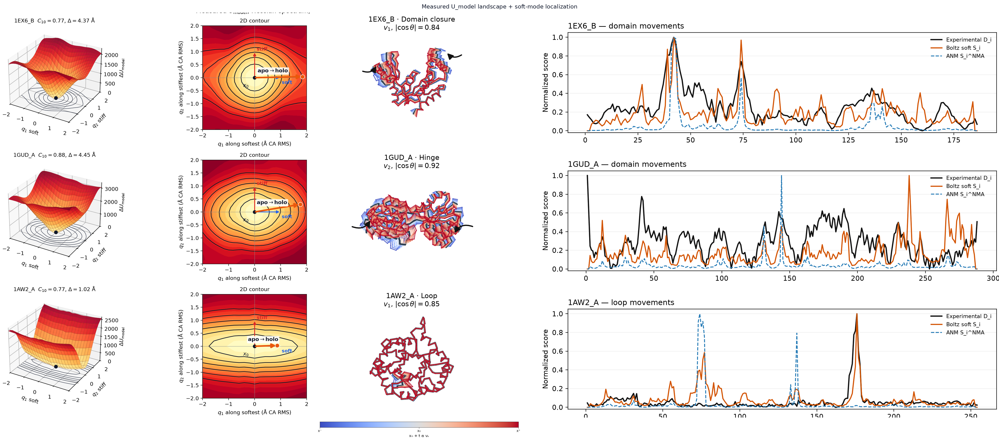

# Mapping Local Energy Landscapes from the Score Function of Biomolecular Diffusion Model (Boltz-2)

## Introduction

Proteins are dynamic molecular systems whose functions frequently depend on transitions between conformational states. Collective domain rearrangements, hinge motions, localized loop fluctuations, and ligand-induced changes in flexibility underlie molecular recognition, catalysis, transport, and allosteric regulation. Consequently, predicting a single three-dimensional structure provides only a partial description of protein function. Molecular dynamics (MD) and normal mode analysis (NMA) provide established approaches for studying such motions, but require an additional physical model after structure prediction and, in the case of simplified elastic-network approaches such as the anisotropic network model (ANM), describe fluctuations through a harmonic approximation around a reference structure.

Modern protein structure predictors offer a potentially different source of conformational information. Although these models are optimized primarily to predict structure rather than molecular thermodynamics, neural networks can implicitly define probability or energy-like functions that contain information not directly exposed in their primary outputs. More generally, discriminative neural networks can be reinterpreted as energy-based models through their learned logits [1]. This perspective has recently been extended to protein structure predictors: confidence heads of structure-prediction models can be reinterpreted as energy-based models and used to derive continuous interaction-energy scores associated with experimental binding energetics [2].

Diffusion-based structure predictors provide an even more direct connection to statistical-mechanical interpretations. A score-based diffusion model learns a vector field approximating the gradient of the log probability density,

```
s_θ(x, σ) ≃ ∇_x log p_σ(x),
```

which can be interpreted, under a statistical-mechanical analogy, as proportional to the negative gradient of an implicit learned energy. Recent work has explored this interpretation explicitly in generative protein diffusion models, showing that learned negative log-likelihoods can be extracted and used to construct energy-like landscapes that can be compared with conventional physical energy functions [3]. Importantly, such a learned potential need not coincide with the physical molecular potential: a learned statistical landscape can reproduce structural preferences while differing substantially from the underlying thermodynamic free-energy surface. Thus, the diffusion score is more appropriately interpreted as defining the geometry of a learned structural distribution than as a molecular-mechanics force field.

Whether this learned geometry contains information about protein conformational motion remains unresolved. Standard structure-prediction inference frequently concentrates on a dominant conformational state rather than reproducing the experimentally accessible ensemble. Studies of apo and holo proteins have shown that AlphaFold2 predictions can be biased toward particular conformational states and that increasing experimental conformational diversity makes prediction of the full ensemble difficult [4]. Likewise, comparisons with experimental NMR dynamics indicate that AlphaFold-derived confidence can broadly distinguish rigid from flexible regions but does not faithfully reproduce the gradations of dynamics within flexible regions; NMA performed on AlphaFold models similarly shows limited correspondence with these experimental gradations [5]. These observations highlight an important distinction between accurately predicting a representative structure and representing the conformational landscape associated with that structure.

However, failure to sample an equilibrium ensemble does not necessarily imply that conformational information is absent from the model. A structure predictor may concentrate its inference distribution around one state while retaining internal representations learned from statistical regularities across many proteins and structural contexts. Recent approaches support this possibility. Entropy-guided perturbation of AlphaFold2 intermediate representations can expose alternative conformational states that are rarely recovered by standard inference [6]. Similarly, modifications of MSA information can expand apo/holo conformational sampling, including recovery of ligand-bound-like conformations without explicit ligand information [7]. More directly for Boltz-2, scaling its latent pair representation has been reported to substantially increase multi-state recovery relative to vanilla inference, with improvements persisting under sequence-only inference [8]. Together, these results suggest that failure to express conformational diversity during standard inference may reflect how learned information is read out, rather than its complete absence from the model.

This motivates a different question from whether a structure predictor can directly sample the equilibrium ensemble of an individual protein. I ask whether conformational accessibility is encoded in the local geometry of the learned structural distribution, even when conventional inference produces a single dominant structure. A model trained across many proteins may learn recurring statistical relationships between sequence, molecular context, structural geometry, and conformational variability. Consequently, even when inference collapses these possibilities into a dominant prediction x*, the probability landscape surrounding that prediction may remain strongly anisotropic: structural variations learned to be compatible with the protein context may correspond to softer directions, whereas strongly constrained variations may correspond to higher-curvature directions.

Here, I investigate this hypothesis in Boltz-2 by treating its diffusion score as an object that can be interrogated beyond its conventional role in structure generation. Around a predicted structure x*, I examine the local Jacobian of the score,

```
H_score(x*) = −∇_x s_θ(x*),
```

and perform **spectral decomposition** to obtain score-Hessian modes. The lowest-curvature eigenvectors define a learned conformational soft subspace, providing a directional description of how the model's structural probability varies around its prediction. I test whether experimentally observed conformational displacements are preferentially represented within this soft subspace and whether these modes recover collective domain rearrangements and localized functionally associated motions.

I compare the learned score-Hessian modes with ANM as a simple harmonic mechanical baseline. This comparison asks which aspects of experimentally observed motion can be explained by the geometry of an elastic network and which are additionally represented in the learned score landscape. The score Hessian itself remains a local second-order description and therefore should not be interpreted as intrinsically anharmonic. However, unlike the fixed quadratic landscape defined by ANM, it is the local derivative of an underlying nonlinear, context-dependent score field. This provides a route to interrogating how conformational softness changes with coordinates and molecular context, potentially exposing position-dependent and interaction-dependent organization not contained in a single harmonic approximation.

I show that experimentally observed conformational changes are enriched in low-curvature directions of the Boltz score landscape, demonstrating that conformational information can be recovered from the model beyond its final predicted structure. Comparison with ANM reveals both shared collective organization and differences in the representation of localized motions. These results support a view of diffusion-based protein structure predictors not only as generators of static structures, but as learned statistical models whose internal geometry can be interrogated to extract conformational information relevant to protein motion and function.

## Method


### Local score geometry and its statistical-mechanical interpretation

I interpret the Boltz diffusion model as defining a learned probability distribution over molecular configurations and ask whether the local geometry of this distribution contains information about experimentally accessible conformational motions. Rather than modifying or retraining Boltz, I directly interrogate the score field learned by the pretrained model. This approach is motivated by the statistical-mechanical connection between probability, energy, force, and curvature, while maintaining an important distinction between a learned structural distribution and a physical molecular potential.

For an equilibrium molecular system with coordinates x, the Boltzmann distribution relates the probability of a configuration to its free-energy landscape,

```
p(x) = (1/Z) exp[−β U(x)],
```

where U(x) is the potential or effective free energy, Z is the partition function, and β = (k_B T)⁻¹. Taking the gradient of the log probability gives

```
∇_x log p(x) = −β ∇_x U(x) = β F(x),
```

where

```
F(x) = −∇_x U(x)
```

is the corresponding force. Thus, in an equilibrium statistical-mechanical system, the score of the probability distribution is proportional to a force field.

Score-based diffusion models provide an analogous mathematical object. At diffusion noise level σ, the model approximates the score of a noise-smoothed structural distribution,

```
s_θ(x, σ) ≃ ∇_x log p_σ(x).
```

For the EDM parameterization used here, I obtain the score from the Boltz denoiser D_θ as

```
s_θ(x, σ) = (D_θ(x, σ) − x) / σ².
```

This relation provides a statistical-mechanical interpretation of the learned score as a force-like vector field acting on molecular coordinates. Related work has used this connection to recover learned energy-like quantities from protein diffusion models and compare them with conventional molecular energy functions [3]. I emphasize, however, that the Boltz score is not assumed to represent the physical molecular force. It describes gradients of a learned, noise-dependent structural probability distribution and may incorporate statistical regularities arising from structural, sequence, evolutionary, and molecular-context information represented by the model.

### From the score to local conformational curvature

I next consider the derivative of the score with respect to molecular coordinates. In the statistical-mechanical analogy,

```
H_score(x, σ) = −∇_x s_θ(x, σ).
```

If the score corresponded exactly to an equilibrium distribution,

```
s(x) = −β ∇ U(x),
```

then

```
H_score = β ∇²_x U(x),
```

and the score Jacobian would therefore be proportional to the Hessian of the corresponding energy landscape. This establishes a direct mathematical connection to normal mode analysis.

I first optimize the predicted coordinates toward a local score-stationary configuration x*, satisfying approximately

```
s_θ(x*, σ) ≃ 0.
```

Around this point, the score can be locally expanded as

```
s_θ(x* + δx, σ) ≃ −H_score(x*, σ) δx + O(‖δx‖²).
```

Equivalently, under the conservative energy analogy, the corresponding local landscape is

```
U_learned(x* + δx) ≃ U_learned(x*) + (1/(2β)) δxᵀ H_score δx + ⋯ .
```

I remove global translations and rotations and compute the low-curvature spectrum through Hessian-vector products and Lanczos eigendecomposition,

```
H_score v_i = λ_i v_i.
```

The resulting eigenvectors v_i define score-Hessian modes. Low-curvature modes correspond to directions along which the learned structural distribution changes relatively slowly and therefore define a learned conformational soft subspace.

Importantly, I use the terms soft and stiff with respect to the learned score landscape, rather than assigning the eigenvalues physical force constants or vibrational frequencies. A low score-Hessian eigenvalue indicates that Boltz locally constrains that collective coordinate weakly relative to other directions; it does not by itself establish that the coordinate has low physical free energy or a particular thermodynamic fluctuation amplitude.

### Relationship to normal mode analysis

This construction has the same local spectral mathematics as conventional normal mode analysis but differs in the origin and interpretation of the Hessian. In molecular-mechanics NMA, one begins with an explicit physical potential U_MM(x), minimizes it to obtain x*, and computes

```
H_MM = ∇²_x U_MM(x*).
```

Diagonalization, conventionally after mass weighting, identifies vibrational and collective modes of the molecular-mechanical potential.

ANM provides a simpler approximation. The protein is represented as a network of residues connected by harmonic springs, giving locally

```
U_ANM(δx) = (1/2) δxᵀ H_ANM δx.
```

Its lowest-frequency modes frequently describe large-scale collective motions such as hinge bending and domain closure. However, within this harmonic description the Hessian is fixed: the same quadratic landscape determines the response in either direction around the reference configuration.

My Boltz analysis differs because

```
H_Boltz(x) = −∇_x s_θ(x)
```

is derived from a nonlinear learned score function. At a single structure, diagonalizing H_Boltz(x*) remains a local harmonic analysis, just as NMA is a local harmonic analysis of a molecular-mechanics potential. The distinction appears when I interrogate the score at neighboring configurations. In general,

```
H_Boltz(x* + δx) ≠ H_Boltz(x*).
```

Thus, while the score-Hessian spectrum provides a local linearization, the underlying score field can contain higher-order, position-dependent information that is absent from a fixed harmonic elastic-network description.

### Experimental conformational motions as a test of the learned geometry

I test whether the low-curvature directions extracted from Boltz correspond to experimentally observed protein conformational changes. For proteins with experimentally determined alternative conformations, I define the aligned displacement

```
Δx_exp = x_state2 − x_state1.
```

For the first k score-Hessian modes collected in an orthonormal basis V_k, I quantify the fraction of the experimental displacement contained in the learned soft subspace as

```
C_k = ‖V_k V_kᵀ Δx_exp‖² / ‖Δx_exp‖².
```

This quantity asks whether the experimentally observed transition lies preferentially along directions that Boltz locally considers soft. I compare this representation with random subspaces and with ANM modes computed for the same protein geometry. This comparison does not assume that Boltz modes are physical normal modes. Rather, it tests whether normal-mode-like organization emerges in the learned structural distribution and whether that organization contains experimentally relevant conformational information.

I additionally distinguish collective and localized conformational changes. Collective motions are evaluated through the alignment of experimental displacements with the learned low-dimensional soft subspace, whereas residue-level mode participation,

```
S_r = Σ_{i=1..k} ‖v_{i,r}‖²,
```

measures how strongly individual residues participate in the learned soft modes. This allows me to ask whether Boltz identifies not only global conformational coordinates but also localized regions involved in experimentally observed functional rearrangements.

### Beyond the harmonic approximation

Finally, I use the full score field to test whether Boltz contains conformational information beyond that available from a single Hessian. Along a local conformational coordinate d, I evaluate

```
x(α) = x* + α d
```

and re-query the score,

```
g(α) = s_θ(x(α), σ)ᵀ d.
```

For a purely quadratic landscape with constant Hessian,

```
g(α) = −κ α,
```

and the response is symmetric:

```
g(+α) = −g(−α).
```

Deviations from this relation provide a direct local measure of higher-order structure in the learned field. I therefore examine directional asymmetry, changes in directional curvature,

```
κ(α) = dᵀ H_score(x(α)) d,
```

and rotation of the low-curvature subspace,

```
V_k(x*) → V_k(x* + α d).
```

These observables distinguish two complementary levels of information contained in Boltz. The score Hessian describes which collective coordinates are locally soft, whereas changes in the score and its Hessian across nearby configurations describe how those preferences evolve as the structure moves. The latter can reveal progressive stiffening or softening, directional asymmetry, and coupling between conformational coordinates that cannot be represented by a single fixed harmonic ANM landscape.

I therefore use ANM not only as a performance baseline but also as a controlled harmonic reference. This enables me to test whether Boltz has learned conformational organization that can be explained by simple structural mechanics and, separately, whether its nonlinear score field contains additional position- and context-dependent information associated with experimentally observed protein motions.

## Results


### Soft-subspace enrichment for apo↔holo motions

I first asked whether experimentally observed conformational changes preferentially align with low-curvature directions of the Boltz score landscape. I evaluated this question on a curated panel of 91 apo–holo pairs from the CoDNaS database [9], which catalogs experimentally observed conformational diversity among structures of the same protein. The panel spans two mechanistically distinct classes of conformational change, assigned using DynDom: 55 domain movements, characterized by collective rearrangements of larger structural units, and 36 loop movements, representing more localized structural changes. This dataset therefore provides a natural benchmark for testing whether the learned score geometry captures both collective and localized experimentally observed motions.

For each apo–holo pair, I defined the experimental conformational displacement as

```
Δx = x_holo − x_apo,
```

after structural alignment and residue matching. Starting from the Boltz-predicted structure, I performed score ascent to obtain a local score-stationary configuration x*, computed the score Hessian, and extracted its lowest-curvature Cα modes. I quantified the correspondence between these modes and the experimental transition using

```
C_10 = ‖V_10 V_10ᵀ Δx‖² / ‖Δx‖²,
```

where V_10 contains the ten softest score-Hessian modes. Thus, C_10 measures the fraction of the experimental displacement contained within the learned ten-dimensional soft subspace. For each protein, I compared this value with a matched random-subspace null distribution generated from 500 random directions. As a complementary measure, I evaluated the directional curvature

```
κ_exp = (Δxᵀ H Δx) / ‖Δx‖²,
```

and compared it with the curvature along matched random directions.


|                                  | all (91)      | domain (55)   | loop (36)     |
| -------------------------------- | ------------- | ------------- | ------------- |
| C_10 enriched vs. null           | 91 / 91       | 55 / 55       | 36 / 36       |
| κ_exp softer than null           | 91 / 91       | 55 / 55       | 36 / 36       |
| Median C_10, experimental / null | 0.256 / 0.018 | 0.296 / 0.015 | 0.235 / 0.024 |
| Median enrichment                | 13.2×         | 17.1×         | 11.4×         |


Experimental conformational changes showed a consistent enrichment in the learned soft subspace. In all 91 proteins, C_10 exceeded its matched random expectation, with a median C_10 of 0.256 compared with 0.018 for the null. Experimental directions were also systematically softer according to the score-Hessian curvature, with κ_exp below the matched random expectation in all 91 systems. These complementary measurements show that experimental transitions preferentially occupy directions to which the Boltz score landscape assigns low local curvature.

The enrichment was strongest for collective domain movements. The ten softest score-Hessian modes captured a median of 29.6% of the experimental displacement, compared with only 1.5% for random subspaces, corresponding to a 17.1-fold median enrichment. This result is consistent with large-scale hinge and domain rearrangements being representable by a small number of collective soft coordinates.

Importantly, the effect was not restricted to global motions. For the 36 loop-motion systems, the soft subspace captured a median of 23.5% of the experimental displacement, compared with 2.4% under the random null, corresponding to an 11.4-fold enrichment. Thus, although domain rearrangements show the strongest enrichment, localized experimental conformational changes are also preferentially represented by low-curvature directions of the learned score landscape.

These results provide evidence that experimentally relevant conformational information is encoded in the local geometry of the Boltz score field. Even when inference returns a single structural prediction, the curvature around that prediction is anisotropic in a manner that preferentially aligns with experimentally observed alternative conformations. This motivates asking next how much of this signal reflects generic harmonic structural mechanics, and how much is specific to the learned Boltz landscape.

### Local score landscape and soft-mode localization

To visualize how experimental motions sit in the learned geometry, I examine three representative CoDNaS systems around their score-stationary predictions (Figure below). For each protein I evaluate a score-derived potential U_model in the plane of the softest and stiffest Hessian modes, project the experimental apo→holo Δx into that plane, morph along soft modes, and compare per-residue experimental displacement D_i with Boltz soft-mode participation S_i (and ANM participation as a harmonic baseline).

I define U_model from the diffusion score by the statistical-mechanical identification U_model ≡ −log p_σ (up to an additive constant), so that s_θ = ∇_x log p_σ implies ∇_x U_model = −s_θ. After score ascent to a stationary pose x*, I therefore recover relative potential differences by integrating this force along displacements rather than by fitting a quadratic Hessian ellipse. Along a unit mode v, the directional derivative is

```
dU_model / dα = −⟨s_θ(x* + α v, σ), v⟩,
```

and U_model(α) is obtained by trapezoidal integration with U_model(0) = 0. On the two-mode plane Δ = q1 v_soft + q2 v_stiff I use the same identity with a two-point trapezoid from x* to x* + Δ,

```
U_model(x* + Δ) ≈ −½ ⟨s_θ(x*, σ) + s_θ(x* + Δ, σ), Δ⟩,
```

again pinning U_model(x*) = 0. Because both endpoints are re-scored by the nonlinear denoiser, anharmonicity is visible in the measured landscape and is not forced to be a pure Hessian paraboloid.



The three rows illustrate distinct functional motion classes:

- **1EX6_B → 1EX7_A (domain closure; RMSD ≈ 4.4 Å).** A multi-domain rearrangement. Soft score-Hessian modes concentrate along the closure coordinate; the apo→holo arrow lies in a low-U_model valley of the soft×stiff plane, and soft-mode morphs recover a domain-closure cartoon.
- **1GUD_A → 1RPJ_A (hinge; RMSD ≈ 4.5 Å).** A hinge-bending domain motion. Soft modes again track the experimental collective coordinate, with participation profiles peaking at the hinge and moving domains.
- **1AW2_A → 1AW1_B (loop; RMSD ≈ 1.0 Å).** A localized loop rearrangement rather than a global domain shift. Here the contrast with ANM is clearest: a fixed elastic-network Hessian tends to place soft mass in delocalized, low-frequency collective modes of the contact graph, which can miss or dilute short, local loop displacements. Boltz soft-mode participation S_i instead concentrates on the experimentally mobile loop region, mapping the functional loop motion into the learned soft subspace even though the absolute Cα RMSD is small.

Together with Exp. 1, these examples show that score-Hessian modes can represent both collective and localized experimental degrees of freedom, and that for loop-like motions the learned soft subspace recovers spatial localization that a purely harmonic ANM baseline does not emphasize. Figure source: `experiments/2_x0_landscape/outputs/score_landscape/trio_3d_2d.png`.

### Blind retrieval of PSCDB moving segments: local vs domain

I next asked whether the spatial distribution of the Boltz soft modes can identify experimentally mobile regions without using the experimental displacement Δx. I evaluated this on the Protein Structural Change Database (PSCDB), which classifies ligand-associated structural changes according to both their spatial extent and their coupling to ligand binding. After quality control, the benchmark contained 219 systems spanning four PSCDB classes: local and domain-scale motions, each further divided according to their coupling to ligand binding.

For each system, I mapped the PSCDB moving-segment or moving-domain annotations onto the corresponding Cα residues, defining each residue as experimentally moving or non-moving. I then assigned each residue a Boltz soft-mode participation score,

```
S_i = Σ_{k=1..10} ‖v_{k,i}‖²,
```

where v_{k,i} is the three-dimensional displacement of residue i in the k-th score-Hessian mode. Importantly, neither the experimental displacement nor the moving-region annotation is used to construct the modes or participation scores. I compared these scores with the equivalent participation obtained from the ten softest ANM modes, with both methods evaluated on the same predicted Cα geometry. Performance was measured by AUROC for discriminating annotated moving from non-moving residues, and I defined

```
ΔAUROC = AUROC_Boltz − AUROC_ANM.
```


| class            | n   | median AUROC Boltz / ANM | median ΔAUROC [95% CI]  | Boltz / ANM wins |
| ---------------- | --- | ------------------------ | ----------------------- | ---------------- |
| IL               | 78  | 0.905 / 0.818            | +0.033 [+0.015, +0.074] | 54 / 24          |
| CL               | 68  | 0.894 / 0.704            | +0.133 [+0.092, +0.184] | 56 / 12          |
| CD               | 31  | 0.539 / 0.571            | −0.049 [−0.137, −0.016] | 10 / 21          |
| ID               | 42  | 0.624 / 0.668            | −0.046 [−0.138, +0.006] | 16 / 26          |
| IL + CL (local)  | 146 | 0.901 / 0.771            | +0.086 [+0.044, +0.129] | 110 / 36         |
| CD + ID (domain) | 73  | 0.584 / 0.601            | −0.049 [−0.132, −0.016] | 26 / 47          |


A clear dependence on the spatial scale of the conformational change emerged. For localized motions, Boltz achieved a median AUROC of 0.901 compared with 0.771 for ANM. The median paired improvement was ΔAUROC = +0.086, with a 95% confidence interval excluding zero, and Boltz outperformed ANM in 110 of 146 systems. The largest difference occurred in the CL class, where the median ΔAUROC reached +0.133.

In contrast, I did not observe a Boltz advantage for domain-scale motions. Across the 73 CD and ID systems, median AUROC was 0.584 for Boltz and 0.601 for ANM, corresponding to a median ΔAUROC of −0.049. ANM outperformed Boltz in 47 of 73 domain-motion systems. The difference between the local and domain regimes was substantial: the local-minus-domain contrast in median ΔAUROC was +0.136 [95% CI: +0.077, +0.218].

These results reveal a complementary regime between the learned score geometry and a conventional elastic-network description. ANM remains competitive for domain-scale rearrangements, where motion is distributed across large structural units and can often be represented by collective modes arising directly from protein geometry. In contrast, Boltz more accurately localizes the experimentally mobile residues for local structural changes. This suggests that the spatial organization of the learned soft modes contains information about local conformational susceptibility that is not captured as effectively by the ANM contact network alone.

Importantly, this result concerns where conformational change occurs, rather than the direction of that change. The participation score S_i removes the vector direction of each mode, and AUROC measures whether experimentally mobile residues receive higher softness scores than non-mobile residues. I therefore interpret this analysis as evidence that Boltz score-Hessian modes provide improved blind localization of local conformationally mobile regions, rather than as evidence that Boltz more accurately predicts the full displacement vector of localized motions. This distinction motivates separately evaluating directional and subspace agreement with experimentally observed conformational changes.

## References

1. Grathwohl, W., Wang, K.-C., Jacobsen, J.-H., Duvenaud, D., Norouzi, M. & Swersky, K. Your Classifier is Secretly an Energy Based Model and You Should Treat it Like One. *International Conference on Learning Representations (ICLR)* (2020). [https://arxiv.org/abs/1912.03263](https://arxiv.org/abs/1912.03263)
2. Nori, D., Parsan, N., Uhler, C. et al. Protein Structure Predictors Implicitly Define Binding Energy Functions.
3. Sarma, S., Truscott, H., Xu, D., Reid, K., Chu, L., Chen, J. & Gray, J. J. Can We Extract Physics-like Energies from Generative Protein Diffusion Models? *bioRxiv* (2025). [https://doi.org/10.1101/2025.11.28.690021](https://doi.org/10.1101/2025.11.28.690021)
4. Saldaño, T., Escobedo, N., Marchetti, J., Zea, D. J., Mac Donagh, J., Velez Rueda, A. J., Gonik, E., García Melani, A. et al. Impact of protein conformational diversity on AlphaFold predictions. *Bioinformatics* **38**, 2742–2748 (2022). [https://doi.org/10.1093/bioinformatics/btac202](https://doi.org/10.1093/bioinformatics/btac202)
5. Gavalda-Garcia, J., Dixit, B., Díaz, A., Ghysels, A. & Vranken, W. F. Gradations in protein dynamics captured by experimental NMR are not well represented by AlphaFold2 models and other computational metrics. *Journal of Molecular Biology* **437**, 168900 (2025). [https://doi.org/10.1016/j.jmb.2024.168900](https://doi.org/10.1016/j.jmb.2024.168900)
6. Wu, D. & Feng, L. Robust Prediction of Multiple Protein Conformations with Entropy Guidance. *bioRxiv* (2025). [https://doi.org/10.1101/2025.04.26.650728](https://doi.org/10.1101/2025.04.26.650728)
7. Raisinghani, N., Parikh, V., Foley, B. & Verkhivker, G. AlphaFold2-Based Characterization of Apo and Holo Protein Structures and Conformational Ensembles Using Randomized Alanine Sequence Scanning Adaptation: Capturing Shared Signature Dynamics and Ligand-Induced Conformational Changes. *International Journal of Molecular Sciences* **25**, 12968 (2024). [https://doi.org/10.3390/ijms252312968](https://doi.org/10.3390/ijms252312968)
8. Suzuki, S. & Amagasa, T. Biasing Conformational Sampling in AlphaFold 3 and Boltz-2 via Pair Representation Scaling. *Journal of Chemical Information and Modeling* (2026). [https://doi.org/10.1021/acs.jcim.6c02094](https://doi.org/10.1021/acs.jcim.6c02094)
9. CoDNaS: Conformational Diversity of Native State. Universidad Nacional de Quilmes. [http://ufq.unq.edu.ar/codnas/](http://ufq.unq.edu.ar/codnas/)

